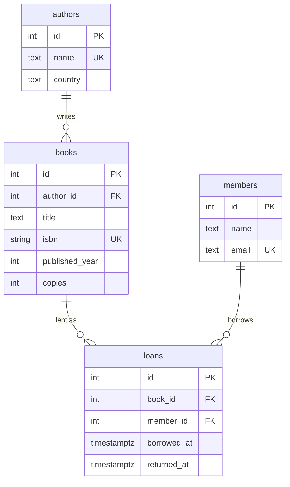

# Library API

REST API for a small library: authors, books, members and loans.
Node 22, Express 5, Sequelize 6, PostgreSQL.

## Run

```shell
docker compose up -d          # PostgreSQL on localhost:5432 (user/password: postgres)
npm install
npm run db:migrate            # creates the tables
npm run db:seed               # sample authors, books and a member
npm run dev                   # http://localhost:3000
```

## Endpoints

| Method | Path | What it does |
|---|---|---|
| GET | `/api/authors` | All authors |
| POST | `/api/authors` | Add an author `{ "name", "country" }` |
| GET | `/api/authors/:id` | One author with their books |
| DELETE | `/api/authors/:id` | Remove an author (refused while they still have books) |
| GET | `/api/books?q=&page=&limit=` | Search books by title, paginated |
| POST | `/api/books` | Add a book `{ "authorId", "title", "isbn", "publishedYear", "copies" }` |
| GET | `/api/books/:id` | One book with its author |
| POST | `/api/members` | Add a member `{ "name", "email" }` |
| GET | `/api/members/:id/loans` | A member's loans |
| POST | `/api/loans` | Borrow a book `{ "bookId", "memberId" }`; 409 when no copy is free |
| PATCH | `/api/loans/:id/return` | Return a book |

Errors: `400` invalid or duplicate data, `404` unknown id, `409` rule broken (no free copy, author still has books).

Example:

```shell
curl http://localhost:3000/api/authors/1
curl "http://localhost:3000/api/books?q=salt"
curl -X POST http://localhost:3000/api/loans -H "Content-Type: application/json" -d '{"bookId":1,"memberId":1}'
```

## Tests

```shell
docker compose exec db createdb -U postgres library_test   # once
npm test                                                     # migrates library_test, then runs the API tests
```

## Database

Schema in `migrations/` (Sequelize migrations), models in `src/models/`.
A book has one author; a member borrows books through `loans`. Borrowing runs in a
transaction that locks the book row, so the last copy cannot be lent twice.



## Project layout

```
migrations/        schema changes, each with up and down
seeders/           sample data
src/config/        database settings per environment
src/models/        Sequelize models and associations
src/controllers/   request handlers
src/routes/        URL routing
src/middlewares/   error handling
tests/             API tests against PostgreSQL
```
