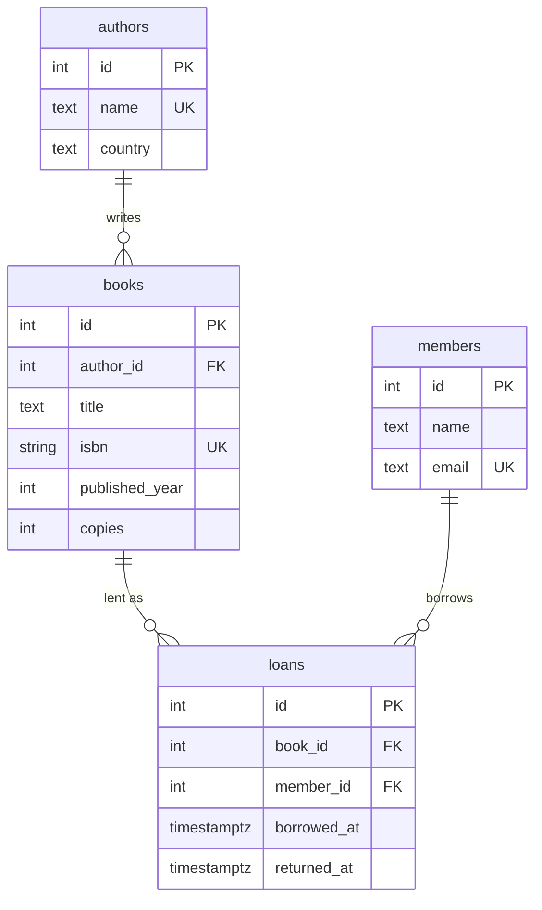

# Library API: learning Sequelize

A small library system (authors, books, members, loans) built to learn
[Sequelize](https://sequelize.org/) with PostgreSQL. Express 5, Node 22, Jest.

What it covers:

| Topic | Where |
|---|---|
| Migrations with `up`/`down`, named constraints, a partial unique index | `migrations/` |
| Seeders | `seeders/` |
| Models with validation, `underscored` column names | `src/models/*.js` |
| One-to-many (`Author.hasMany(Book)`) | `src/models/index.js` |
| Many-to-many through a table with its own columns (`Book` ↔ `Member` through `Loan`) | `src/models/index.js` |
| Eager loading (`include`), filters (`Op.iLike`), pagination (`findAndCountAll`) | `src/controllers/` |
| A transaction with a row lock (borrow a book only if a copy is free) | `src/controllers/loans.js` |
| Turning Sequelize errors into 400 / 404 / 409 | `src/middlewares/errorHandler.js` |
| API tests against a real database | `tests/api.test.js` |

## Run

```shell
docker compose up -d          # Postgres on localhost:5432 (user/password: postgres)
npm install
npm run db:migrate            # creates the tables in library_dev
npm run db:seed               # a few authors and books
npm run dev                   # http://localhost:3000
```

Try it:

```shell
curl http://localhost:3000/api/authors/1              # author with their books
curl "http://localhost:3000/api/books?q=salt"         # search
curl -X POST http://localhost:3000/api/loans -H "Content-Type: application/json" -d '{"bookId":1,"memberId":1}'
```

## Test

```shell
createdb -h localhost -U postgres library_test   # once (or: docker compose exec db createdb -U postgres library_test)
npm test                                          # migrates library_test, then runs the API tests
```

## Tables


